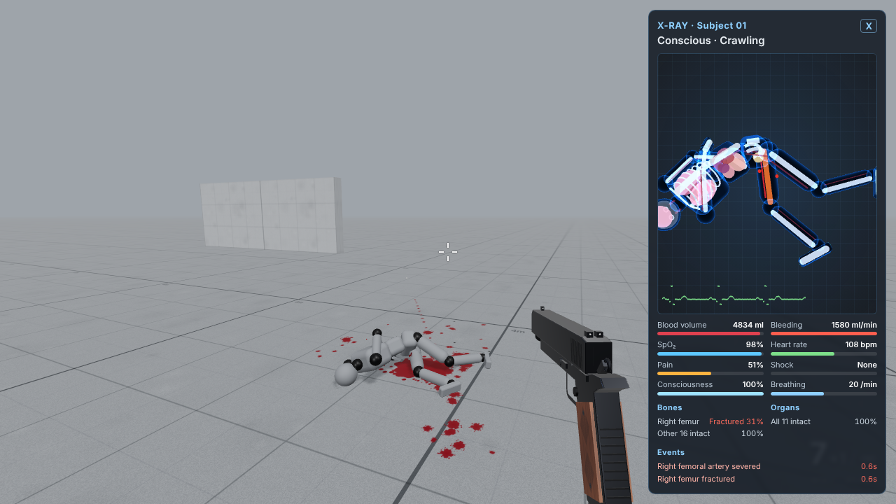

# Ragdoll Sandbox (draft)

**Play:** https://drzoke.github.io/Ragdoll-Sandbox/



A first-person physics sandbox: humanoid ragdolls and zombies, guns from a flintlock musket to a scoped sniper rifle, two maps (a test range and a 20-floor skyscraper), drivable vehicles, saves, multiplayer with chat, and a dynamic damage / gore / physiology model. **VS Undead** is a co-op zombie-wave mode on its own foggy cemetery field, with points, a traveling merchant, supply drops, a boss every third wave (the Big Brute) and its own guns, mines and a sentry gun.
Built with **three.js r187** and **cannon-es 0.20**. Both are bundled locally in `lib/`, so it needs no internet.

## Running it

ES modules don't load from `file://`, so serve the folder with any static server:

```bash
cd ragdoll-sandbox
python3 -m http.server 8000      # or: npx serve .
# open http://localhost:8000
```

## Controls

| Key | Action |
| --- | --- |
| WASD | Move |
| Mouse | Look |
| Shift | Sprint |
| Space | Jump |
| C (hold) | Crouch (Ctrl also works in fullscreen on Chrome/Edge) |
| 1 – 9 or Q | Switch between the items on your bar (you start with Fists; equip more in the toolbox) |
| Mouse wheel | Switch item (with Grab: move what you're holding closer or farther; through the sniper scope: zoom) |
| Shift (scoped) | Hold your breath to steady the sniper scope |
| Tab | Open the toolbox (pick an item, then Equip to put it on your bar) |
| I | Inventory: your character with its armour, health, ammo, points and items |
| B | Spawn menu (ragdolls, zombies and armour) |
| Z | Slow time down (down to 0.01×) |
| V | Speed time up (up to 3×) |
| E | Use what you're looking at: buttons, the elevator (call it, pick a floor), the roof ladder, a vehicle, a supply crate, the merchant |
| T / Enter | Chat (in a multiplayer room) |
| G | VS Undead: ready for the next wave |
| W S / A D / Space / C / click | Driving: throttle and reverse / steer / handbrake / camera / horn (E gets out) |
| X | X-ray / vitals panel: open, press again for the other view (Dynamic 3D / Flat), again to close (Shift + X also switches) |
| H | Hide the tool controls list on the left |
| F3 | Debug overlay |
| Esc | Pause menu (Resume, Maps, Settings, Controls, What's new, Main menu) |

You see your own blocky, Roblox-style hands holding every item. They follow the item through every animation: the support hand fetches a fresh magazine and racks the slide on the M1911, works the pump and loads shells one by one on the shotgun, and pulls the grenade pin.

**Fists:** left click throws quick jabs (left, right, left…), right click a slower, much harder hook. Punches leave purple bruises, make the ragdoll stagger, and a hook to the head can knock it down or out (and give it a bloody nose).

**M1911:** left click fires, right click (hold) aims down sights, R reloads, F inspects.

**M24 Sniper:** a bolt-action rifle with a 5-round magazine and a 4–12× scope. Right click looks through the scope (black ring, mil-dot reticle); scroll or F zooms, and the view drifts in a slow figure eight that gets worse when you move: hold Shift to hold your breath (about 4 seconds, then you gasp and it shakes more for a moment). After each shot the right hand works the bolt (handle up, back, the case flies out, forward, down), which takes you off the scope for a moment. R swaps the magazine. Each round has about three times the energy of a pistol bullet: it goes through bodies, most armour and glass, and a head shot usually ends it.

**Flintlock musket:** a smoothbore musket from the 1700s. Pulling the trigger drops the cock, the flint sparks on the frizzen, the priming flashes in the pan, and after a short random delay the main charge fires a heavy .75 lead ball in a thick cloud of white smoke that hangs in the air for several seconds. About 1 in 25 shots only flashes in the pan (press R to prime it again). It's inaccurate from the hip and still loose when aimed down the barrel. Reloading takes about 6.5 seconds and shows every step: half-cock, bite the paper cartridge, prime the pan, close the frizzen, stand the musket up, pour the powder and the ball, draw the ramrod, ram it home (tap, tap), return the ramrod and cock it.

**Remington 870:** left click fires 8 pellets and the gun pumps itself (the spent red shell flies out). Right click aims, R loads shells one at a time into the tube (6 plus one in the chamber; fire to stop loading early), F inspects. Pellets that stop inside the body still blow blood out of the far side, so a ragdoll shot with its back to a wall paints the wall behind it. Pellets lose power with distance: devastating up close, weak far away. At point blank (under about 4.5 m) four or more pellets on the same body part make one massive wound: a head, hand or foot is blown apart, an arm or leg is torn off, and the chest or belly is ripped open (if dismemberment is on).

**Grenade:** left click pulls the pin and throws it overhand, right click lobs it underhand. Hold either button to keep your arm cocked and see a dotted arc of where it will fly, with a ring where it lands and a faint red circle showing the danger zone; let go to throw (a quick click throws straight away). Looking down at your feet drops it there. The spoon flies off and the grenade goes off 3 seconds later (in world time, so slow motion stretches the fuse). Shooting a live grenade sets it off. The explosion has a white-hot flash, a fireball about 3 to 4 m across, a dark smoke and dust cloud that keeps rising for several seconds, a dust ring, sparks and shrapnel, throws ragdolls, breaks bones, bruises and blackens them with soot, and leaves black scorch marks on the floor and nearby walls. What it does to a body depends on distance and cover:

- **Shrapnel:** about 50 fragments fly in every direction, plus extra ones that hit nearby body parts (more the closer and bigger the part). They are real projectiles, so they wound organs, cut arteries, break bones and go through limbs.
- **Blast:** within about a metre limbs, hands, feet and even the head can be blown apart; within about two metres arms and legs can be torn off. The pressure wave also hurts the lungs and gut, ruptures eardrums and concusses (if dismemberment is off, it only wounds).
- **Burns:** body parts within about 2.5 m of the fireball are burnt on the side facing it: first degree (red), second degree (blistered brown) and third degree (charred black), shown on the body and on the flat X-ray. Fresh burns glow with embers and smoulder for a few seconds. Burns cause severe pain and shock and leak plasma, which counts towards blood loss. Walls block the heat.

**Grab:** right click grabs or drops a body part (or a gib), left click throws what you hold or pushes things in front of you away, and the wheel or R / F pulls it closer or pushes it away. Whatever you hold gets a white outline. The held point trails your aim, and the farther away it is the more it lags. Slamming a ragdoll into the floor or walls breaks bones. A held ragdoll curls up into a fetal position.

**Machete:** left click slashes (alternating forehand and backhand), right click stabs. A slash leaves a long, deep gash that bleeds hard; slashing the same spot cuts deeper until it chops through the arm, leg or neck. Cuts across the wrist, the back of the ankle or the back of the thigh sever tendons, so that hand or leg stops working. A stab goes deep into the organs. Armour stops the blade with a clang. Blood builds up on the blade.

**Medkit:** hold left click on a body part for about a second to treat it: bandages on wounds, a tourniquet above a stump, a splint on a broken bone, a dressing on a burn (you see bands, splints and soaked-through dressings on the body). Right click gives morphine (much less pain, but too much slows breathing), R hangs a blood bag (+750 ml). The status under the item name shows what the part you look at needs.

**Defibrillator:** hold left click to charge, let go with the paddles on the chest to shock. A stopped heart can restart if the heart is still there and there is enough blood (give a blood bag first after heavy bleeding); each extra shock raises the chance. Shocking a beating heart can stop it. The shock arcs, flashes and makes the whole body jerk.

**Spawn menu (B):** laid out like the toolbox: a **Ragdoll** card (a plain gray head) and a **Zombie** card (a rotting green head with blood), with categories on the right (All, Humans, Undead). Pick one, then choose 1, 2, 3, 5 or 8 (up to 12 bodies at once), where (where you look, in front of you or at the spawn point), a helmet and/or a vest, and for ragdolls Classic behaviour or the experimental **V2** behaviour (plus a temperament: Brave, Normal, Timid). Spawn, or double click a card. It can also remove everyone and clean up blood. Armour stops pistol rounds, shotgun pellets and shrapnel until it wears out (dents and sparks), but the body behind it still takes the blow: a helmet hit dazes, a vest hit bruises and can crack a rib. Vests and helmets also soften blasts.

**Zombies:** green, blood-stained ragdolls with pale eyes. A zombie shambles after the nearest living person on its own floor (you or a ragdoll), arms out in front, groaning; gunshots and explosions draw it in. In reach it lunges and claws you or bites a ragdoll (a ragged wound on an arm, the chest or the throat). Zombies feel no pain and don't need blood, a heart or air: knock one down and it gets back up, take its legs and it crawls after you. Only destroying the brain, blowing the head apart or taking the head off puts one down. A bite infects: a bitten ragdoll gets a fever, dies about a minute later (or sooner from its wounds) and rises again as a zombie 7 to 10 seconds after death, unless the head was destroyed.

**Your health:** zombie hits, falls from higher than about 4.5 m and grenades going off near you (walls and floors soak most of it) cost health. A red edge shows damage, and below 30 a heartbeat thumps. Health comes back after 5 seconds without getting hurt. At 0 the view drops to the floor and a **You died** screen offers Respawn (or Space), back at the start of the map.

**Maps (menu):** **Test Range**, the open concrete floor with test blocks, and **Skyscraper**: a city block with streets, parked cars, traffic lights, trees and a skyline, around a 20-floor glass office tower. Walk in through the sliding doors, call the elevator with the button by its doors, step in and press E on the panel to pick a floor (every floor is an open-plan office with desk pods, a meeting room, a lounge and plants). On floor 20 a ladder in the core climbs through a hatch to the roof, with a helipad, machinery and a beacon on the antenna; press E on the hatch to climb back down. The windows are real glass panes: bullets, grenades and bodies thrown into them shatter them, and you (or a ragdoll) can fall out. Ragdolls ride the elevator with you if they're in the car.

**Menus:** the game opens on a title screen with a slow cinematic camera around a dead, badly hurt ragdoll slumped against a wall (on a set far outside the play area, so you never meet it in the game), with Play, Settings, Controls and What's new. Esc opens the pause menu, which adds Resume and Main menu.

Switching items plays a draw animation: the tool comes up from below, rises a little past its resting spot, then settles.

**Toolbox (Tab):** you start with only your fists on the bar. The toolbox is a square window listing every item in a scrolling grid, with categories on the right (All, Weapons, Medical, Tools). Click an item to see what it does, then press **Equip** (or double click it, or press Enter) to put it on your bar and take it out. The bar holds up to 9 items, numbered 1 to 9 in the order you equipped them; **Remove from bar** takes one off again, and with a full bar, equipping swaps out the item in your hands. Item previews follow the graphics preset: a picture on Very Low and Low, a spinning 3D model on Medium, and a spinning model with its own effects (the pistol cycles and flashes, the grab tool pulses) on High and Very High, plus a glossy reflection on Very High.

There are two buttons next to the spawn point: **RESPAWN** (new ragdoll) and **CLEAN UP** (removes blood, scorch marks, gibs, casings, shells and live grenades). Shooting a button also presses it.

## Phones and tablets

The game detects phones and tablets (the browser says it's a phone or tablet and has a touch screen; on other systems only when a finger is the only pointer, so touch-screen laptops with a trackpad or mouse keep keyboard and mouse) and switches to touch controls. On Auto it also follows what you use: touching the screen turns touch controls on, and pressing keys or moving a mouse turns them off. **Settings → Touch controls** can force them on or off, and `?mobile=1` / `?mobile=0` in the address forces them too.

- **Sideways, full screen:** tapping **Tap to play** goes full screen and locks the screen sideways (Android). If the phone is upright while you play, a "Turn your phone sideways" screen covers the game. iPhone Safari has no full screen for web pages, so the menu suggests **Share → Add to Home Screen**: the game then opens from its icon full screen and sideways (web app manifest and home screen icons are included).
- **Left thumb:** the move stick. In the Optimal layout it appears wherever your thumb lands on the left side. A light push walks slowly, a full push walks, and pushing forward past the ring sprints (a yellow ring shows it).
- **Right thumb:** drag anywhere to look. The big red fire button also looks while you hold it, so you can fire and track in one motion.
- **Buttons change with the item:** Fire / Aim / Reload / Inspect for the guns, Jab / Hook for fists, Throw / Lob for the grenade, Push or Throw / Grab or Drop / Closer / Farther for Grab. Jump and Crouch (tap to toggle) sit around the fire button, a second fire button sits top left for firing with the left thumb, and a blue **Press** button appears when you look at the Respawn or Clean up button.
- **Top bar:** pause and toolbox on the left; slow time, speed up time and x-ray on the right (the x-ray button goes 3D → Flat → off). The x-ray is a compact panel on phones. Tap items on the bottom bar to switch.
- **Layouts:** Optimal (recommended), Classic (fixed stick, one fire button) and Left-handed (Optimal mirrored). **Edit layout** lets you drag every button and the stick where you want them; that becomes the Custom layout.
- **Touch settings:** look sensitivity, aiming sensitivity, button size, button opacity, aim by tap (toggle) or hold, and sprint by pushing the stick.
- Phones render at a slightly lower resolution than computers to stay smooth and cool.

## Settings

- **Graphics**
  - **Minimum**: pure performance: the lowest resolution, no shadows or reflections, the fewest blood drops, simple ragdoll shapes up close, small far-off things hidden sooner and no decorative grass or mist. Never chosen automatically.
  - **Very Low**: for slow computers and older phones: half resolution, no shadows, far fewer blood drops, simpler materials and pictures instead of 3D previews in the toolbox.
  - **Low**: no shadows, lower resolution, fewer blood drops, flatter materials.
  - **Medium**: sharp sun shadows, full resolution.
  - **High**: soft 4096 shadows, GTAO ambient occlusion, bloom, dirt and wear on models, a brighter grab beam.
  - **Very High**: everything in High, plus screen-space reflections on the floor, normal-mapped surface detail, stronger reflections and a wide glow around the grab beam.
- **Gore**: organs on or off, red or purple blood, dismemberment and exploding body parts on or off.
- **Touch controls**: see Phones and tablets above.
- **HUD**: show or hide the tool controls list, and pick the X-ray view: **Dynamic** (a 3D x-ray that turns with the ragdoll) or **Flat** (a still front-view picture of the skeleton and organs showing the same damage).

**Hardware check:** while the game loads it reads the name of your graphics chip, runs a short GPU test (a heavy shader timed on a small hidden canvas) and a short CPU test, and recommends a preset (shown on the loading screen and marked REC in Settings, with a **Use recommended** button). Until you pick a preset yourself, the recommended one is used. Phones and tablets are kept at Medium or lower. The recommendation takes the screen into account (a Retina laptop or 4K monitor has 2 to 4 times the pixels of a 1080p screen), is careful with laptop GPUs and Apple M chips, and the presets cap their resolution to a pixel budget so very sharp screens don't slow the game down.

**FPS check:** while you play, if the game averages under 40 FPS on the recommended preset it steps the graphics down one level (at most twice) and remembers that for this device. If you picked the preset yourself it only suggests lowering it.

**Dynamic resolution** (Settings, on by default): below 48 FPS the resolution steps down 10% at a time (to 60% at most) and back up after a while above 57 FPS. If a step down doesn't raise the frame rate (the game is held back by something other than pixels, or the screen runs at 30 Hz) it goes back and stops trying until the preset or the map changes. It also leaves the resolution alone while the game's own work (physics, ragdolls, draw calls) fills most of the frame, since fewer pixels can't help then.

**V-sync** (Settings, on by default): off, the game runs extra frames between screen refreshes as fast as it can (input and physics update more often); the frame right before each refresh is still the one shown, and the extra frames pause if the browser falls behind on its refreshes.

**Physics on a separate core** (Settings, on by default): the simulation runs in a Web Worker (`core/physicsWorker.js`) on its own processor core while the main thread draws. The main thread keeps a copy of the cannon-es world that the game reads and writes as before. Each frame, right before drawing, the link (`core/physicsLink.js`) sends the bodies, joints and shapes that were added or removed, every body the game moved, pushed, woke or put to sleep (found by comparing each body with how the worker last left it), changed collision settings, and the muscle and grab-beam targets; the worker steps while the frame is drawn, and its results (positions, speeds, sleep, collisions, and the contacts grenades read) are copied in at the start of the next frame, with any change the game made in between kept on top. The physics is shown one frame later. Ragdoll muscles and the grab beam are plain data run before every step by `core/programs.js`, on whichever side steps. With a core to itself the physics may use up to 90% of real time before it drops to 90 or 60 Hz. The title screen still settles its scene on the main thread, and if the worker can't start or fails, the physics carries on on the main thread.

**Multiplayer** (Multiplayer in the menu): one player hosts a room, friends join with its 5-letter code (or a link ending in `?join=CODE`). Browsers connect straight to each other over WebRTC; PeerJS's free public broker (`lib/peerjs.min.js`, loaded the first time it's used) only introduces them. The host's game is the real one: physics, brains, health and damage run there as usual. Friends run a copy (`net/net.js`): no physics steps there; ragdoll parts, gibs and grenades are placed from the host's position updates (20 a second, binary, over an unreliable channel, shown about 0.1 s behind the host and smoothed between updates), and everything else that shows is sent as an event in step with them: every wound, blood spray, bruise, severed or blown-off limb, opened torso, gib, helmet, grenade and explosion, broken window, spawn, clean-up and map change is replayed on the friend's copy by calling the same Gore and Ragdoll functions with the same arguments (`net/codec.js` turns ragdolls, wounds, organs and vectors into ids and arrays). Each ragdoll's health (vitals, organs, bones, vessels, wounds, the event log, the brain's state) is sent 5 times a second as small pieces, only the ones that changed (a wound's bleeding rate in ~10% steps as it clots), and straight away when a ragdoll dies, falls or turns; a connection that is backed up skips a health update. A friend's shots go to the host, which fires them like its own (hit markers go back to whoever fired); the friend sees the tracer straight away. Every other item splits what it does to the world into `run()` (punch, cut, treat, shock...), which a friend's game sends to the host's instead of running (`act()`/`remote`); the host answers with any message to show. A friend's grab beam is held on the host by a `RemoteGrab` (the same anchor and pull, following where the friend aims). Zombies pick the closest player from `RagdollManager.players` (the host and every friend) and their attacks reach the friend's game. Every player is drawn as a clothed figure in their colour (`net/avatar.js`), batched like the ragdolls, with procedural walking and hands placed on the item they hold. The host's game also moves a pusher body with each friend, so friends shove ragdolls when they walk into them. A friend joining late gets the whole world, including wounds, stumps and missing limbs. The time scale is the host's. When the two browsers can't reach each other directly (two home routers, phone hotspots, school or office networks), the connection goes through a TURN relay: Metered's free Open Relay (ports 80 and 443, also over TLS; `transport.js` signs a short-lived login with its published shared secret) or PeerJS's. Tests can point it at a local broker with `?peer=host:port&ice=none`.

**Debug view** (F3): real FPS (frames counted over half a second), the time one frame and the physics take, the physics rate, draw calls for the whole frame and the ragdoll batches.

**Culling and physics:** the map hides what the camera can't see before each frame. In the skyscraper only the floor you're on is drawn while you're inside (its ceiling, lights, carpet, furniture, elevator doors and the ragdolls on it), all floors' surfaces as one merged mesh from outside, and nothing inside from the roof; the far skyline casts and receives no shadows. Static collision boxes are grouped into compound bodies per 16 m cell, a grid broadphase (`core/broadphase.js`) pairs each moving body only with the static bodies whose boxes it touches and with moving bodies in the same 2 m column, drops jointed pairs itself (cannon-es checks every joint against every pair, which grows with the square of the ragdoll count; the ragdoll joints are marked `skipCollide` instead), pairs the ground plane only with bodies that reach down to it, and a dead body that has stopped moving sleeps (its joints leave the solver) until something hits, pushes or grabs it. The solver does 10 iterations at 120 Hz: small steps keep joints tighter than many iterations (measured: 0.7 mm average joint stretch while walking, against 0.5 mm with 18 iterations and 2.8 mm at 60 Hz). When the physics takes more than 30% of real time it steps at 90 or 60 Hz instead, and goes back up when the load drops. Each frame it runs as many steps as real time needs, as long as they fit in 70% of the frame time (at least 12 ms), and the frame time is capped at 0.1 s, so the game keeps real speed down to 10 FPS and only goes into slow motion below that or when the physics itself can't keep up. The player's movement is split into pieces of at most 12 cm so a slow frame can't carry you through a wall.

**Batched bodies** (`ragdoll/batcher.js`): ragdoll parts, joint balls, eyes, wound and bruise decals, burn shells, stumps, exposed organs and gibs keep their meshes in the scene (so bullets, the grab tool and culling still see them), but with an invisible material; each frame their world matrices are copied into one `InstancedMesh` per material and geometry, so all bodies draw in a few calls. Bruises and burns share one material each and get their colour, opacity and glow per instance. Holders outside the view (with a 3 m margin for shadows) are left out, and ragdoll parts further than a preset distance (9 m on Very Low up to 28 m on Very High, further when zoomed in) use simpler versions of their shapes, about a fifth of the triangles.

Settings are saved in the browser (localStorage).

| Preset | Minimum GPU | Recommended GPU |
| --- | --- | --- |
| Minimum | Anything that runs WebGL 2 | Anything that runs WebGL 2 |
| Very Low | Any graphics chip that runs WebGL 2 | Intel HD 4000 |
| Low | Any graphics chip from the last 10 years (Intel HD 4000, Chromebooks) | Intel UHD 620 |
| Medium | Intel UHD 620 / AMD Radeon Vega 8 | Intel Iris Xe / NVIDIA GTX 1050 |
| High | NVIDIA GTX 1050 Ti / AMD RX 570 | NVIDIA GTX 1660 / AMD RX 5600 XT |
| Very High | NVIDIA GTX 1660 Super / AMD RX 5600 XT | NVIDIA RTX 3060 / AMD RX 6700 XT |

## What's in it

- **Ragdolls**: 16 rigid bodies (gray segments) joined by cone-twist joints (black balls). Knees and elbows act as hinges. "Muscles" are velocity servos that pull each segment towards a target pose. While walking, the hips are held up and the feet step to target positions.
- **Behaviour** (`ragdoll/brain.js`, Classic, the default): idle and short wanders around home → limping (one leg hurt) → falls when support is lost → gets back up if it can, otherwise **crawls** (both legs out) or **writhes** on the ground in pain → unconscious → dead. It also hunches and clutches wounds when hurt, and shivers when in shock.
- **V2 behaviour** (`ragdoll/brainV2.js`, experimental, picked in the spawn menu): V2 ragdolls notice you. Aim at one and it puts its hands up; nearby gunshots and blasts make them duck and cover their heads; enough fear makes them run or crawl away from you, and they back away from a drawn machete. On the ground they shield their face and press a hand on their worst wound, which slows the bleeding.
- **Damage** (`ragdoll/health.js` + `ragdoll/anatomy.js`): each hit is ray-traced through the body part in local space against organs (ellipsoids), arteries and bones (capsules), and rib cage/skull/pelvis shells. Bullets can pass through limbs into the next part. Outcomes include fractures, a shattered bone, severed arteries, destroyed organs, spinal injury (paralysis), a torso torn open (exposed organs) and limb loss.
- **Physiology**: blood volume, bleeding with clotting, arterial pressure, heart rate, SpO₂, breathing, pain (adrenaline masks it), hypovolemic shock classes, consciousness, cardiac arrest and brain death. Nothing dies instantly: even a brain hit or decapitation takes seconds.
- **Exploding parts**: keep shooting a destroyed body part and it bursts. Heads and limbs vanish in a spray of blood, bone and flesh chunks (limbs below it fall off), and torso parts are gutted in place.
- **Bullets** (`weapon/ballistics.js`): real projectiles at 260 m/s with drop and penetration, a tracer streak and a glowing slug, so in slow motion you can see them travel and hit.
- **Grab tool** (`weapon/grab.js`): a force-limited joint to a kinematic anchor that trails the aim point, a pulsing white beam drawn as a camera-facing Bézier ribbon, throw, punt and drop. Collisions on every body part feed blunt trauma and bone breaks (`Health.impact`).
- **Blood on walls** (`gore/particles.js`, `gore/decals.js`): blood drops that fly into the side of a wall or block leave splats stretched in the direction they were flying, and once enough blood collects it runs down the wall. Bullets that already passed through someone carry blood to the wall or floor they hit.
- **Bruises** (`Gore.addBruise`): punches, hard landings, slams with the grab tool and blasts leave purple bruises that come up over a second or two, merge when they overlap and darken from red-purple to deep purple. Blasts also leave black soot on the body, and burnt parts get a burn shell (red flush, blistered brown, then char) plus glowing burn marks.
- **Gore** (`gore/`): blood particles that pool on the floor (instanced decals that grow and darken), arterial spurts that pulse with the heartbeat, entry and exit wound decals with blood runs, stumps with bone, exposed intestines, ribs and brain, and physical gibs.
- **Hands** (`weapon/arms.js`): box hands, forearms and sleeves placed on anchor points on each item; animation clips can move a hand between named targets (grip, pump, magazine, loading port, belt pouch).
- **Remington 870** (`weapon/model870.js`, `weapon/shotgun.js`): procedural receiver, barrel, magazine tube, ribbed walnut pump, stock with recoil pad, bead sight and red 12 gauge shells. Pellets are ordinary projectiles with lower energy and a shared shot (four or more pellets in one ragdoll knock it down).
- **Grenades** (`weapon/grenadeModel.js`, `weapon/grenade.js`, `weapon/explosives.js`): physics ball with bounce sounds and a fuse smoke wisp; the explosion handles blast falloff with cover (walls block it), knockback, `Health.blast` (fractures, organ damage, blowing off or tearing off parts), fireball heat with `Health.burn` (burn degree, pain, shock, plasma loss), random and aimed shrapnel through the normal bullet system, smouldering smoke, scorch decals, and camera shake.
- **Fists** (`weapon/fists.js`): raycast punches with impulse, `Health.punch` (pain, knockouts, nose bleeds, rare fractures) and bruises.
- **M1911** (`weapon/`): procedural model (extruded slide/frame profiles, checkered wood grips, hammer, sights, mag). Recoil uses camera springs plus partial permanent muzzle climb, and the viewmodel kicks and flips around the grip. The slide cycles, the hammer drops and re-cocks, the slide locks back on empty, casings eject, and there's a muzzle flash, a side flame and a light. Reload (tactical and empty) and inspect are keyframed clips in `weapon/anim.js`.
- **X-ray panel** (`ui/xray.js`, `ui/hud.js`): Dynamic mode uses a second renderer to draw the targeted ragdoll's bones, organs, arteries and wounds on their own render layer, colour-coded by damage. Flat mode draws the same anatomy and damage as a still, front-on diagram on a 2D canvas (fractures get a crack mark, severed parts are dashed). The panel also shows vitals bars, an ECG trace, damaged bones and organs, and an event log.
- **Player** (`player/controller.js`): kinematic controller with acceleration and friction, step-up, coyote time, jump buffering, crouch with head clearance, head bob, strafe tilt, landing dip and sprint FOV. A kinematic physics body follows you, so you shove ragdolls.
- **Medical** (`weapon/medkit.js`, `weapon/defib.js`, `Health.treat`, `giveMorphine`, `giveBlood`, `defibrillate`): treatments change the physiology (bleed rates, pain, breathing, blood volume, heart rhythm) and are drawn on the body (`Gore.bandage`, `tourniquet`, `splint`, `paddleMarks`).
- **Armour** (`Ragdoll.addArmor`, `Ballistics.armorHit`): helmet and vest meshes with their own hit points; they dent, spark, wear out and then let rounds through. A helmet can be knocked off.
- **Title scene** (`ui/title.js`): builds the menu corpse with the real damage systems (shots, cuts, a severed forearm, burns) and pre-rolls the physics so it settles before you see it.
- **Maps** (`world/map.js`, `world/maps.js`): `GameMap` loads a map definition (bounds, spawn points, lights, fog, a `build()` function) and keeps the shared parts (sky, sun, the title set). Map geometry is batched into a few meshes (`world/build.js`), collision boxes live in a uniform grid (`world/grid.js`) so the player, particles and explosions only check nearby boxes, and every system asks the map for the floor height under a point, so ragdolls, blood and casings work on any floor.
- **Test Range** (`world/range.js`): 4 m prototype-grid concrete floor, a few test blocks, and invisible walls at ±45 m.
- **Skyscraper** (`world/tower.js`, `world/towerTextures.js`, `world/elevator.js`, `world/glass.js`, `ui/floorpicker.js`): procedural city block and 21-level tower with canvas-painted textures (asphalt, carpet, ceiling tiles, facades, signs), per-floor culling (only your floor is drawn from inside), breakable glass panes (instanced, with flying shards), an elevator with landing doors, call buttons, floor indicators and a floor picker, and a scripted ladder climb to the roof.
- **Sniper and musket** (`weapon/modelRifles.js`, `weapon/sniper.js`, `weapon/musket.js`): procedural rifle (bolt, scope, magazine, muzzle brake) and musket (lock with cock, frizzen and pan, ramrod, brass fittings); the scope is a DOM overlay and the musket smoke is a pool of world-space sprites.
- **Zombies** (`ragdoll/zombie.js`, `Health.updateUndead`, `Ragdoll.makeZombie`, `RagdollManager.reanimate`): a brain that hunts the nearest living person on its floor, an undead health mode, the bite infection and reanimation.
- **Player health** (`player/vitals.js`): health, regeneration, body armour (VS Undead), the damage vignette, the death screen and respawn.
- **VS Undead** (`mode/undead.js`): the wave loop (prep, wave, break, game over), host-authoritative points and kill credit (`Ragdoll.lastBy`, set by bullets, blasts and melee), zombie spawning at the fog edge with an alive cap that follows the graphics preset and the physics load, body cleanup, supply crates, the merchant's shop and its co-op sync (`{t:'vs'}` state from the host, `vsRequest` / `sendTo` for buying, crates and gadgets). Zombies in this mode also go down from heavy body damage (`Health.bodyDeath`), though their torso shrugs off half of it (`Health.bodyResist`), so headshots are the way. Waves are 2 zombies, plus 2 per wave; every third wave is a boss.
- **The Big Brute** (`mode/brute.js`: the model, its poses and the dig-out keyframes; `mode/boss.js`: the fight). A hand-animated boss (no physics): cutscene camera, health bar, swipes with knockback, a ground slam (shockwave), a charge, roars that raise 2 to 4 minions, rage below 40%. The host runs it and sends its state ten times a second (`{t:'vs', b:[...]}`); bullets, blades and blasts hit its meshes (`userData.brute`, `zone`), friends' hits go through the host.
- **Loading screen** (`ui/loading.js`): covers going into and out of VS Undead (map build, then `compileAsync` of the shaders).
- **Inventory** (`ui/inventory.js`, key I): the multiplayer avatar drawn on its own with armour pieces, plus health, armour, ammo, points and the item slots.
- **Dead Field** (`world/cemetery.js`): the VS Undead map. Hidden from the Maps list (`hidden: true`).
- **Merchant, cart and crates** (`mode/props.js`), **mines and the sentry gun** (`mode/gadgets.js`), **automatic guns** (`weapon/autogun.js`, `weapon/modelAuto.js`) and the shared **ammo store** (`weapon/ammo.js`: unlimited in the sandbox, counted in VS Undead).
- **Vehicles** (`vehicle/vehicles.js`, `vehicle/models.js`): kinematic cars with a simple bicycle model, wall collisions, a chase camera, and running people over through `Health.impact`.
- **Saves** (`ui/saves.js`): scenes kept in `localStorage` (index plus one entry per save, with a thumbnail).
- **Chat** (`ui/chat.js`): the multiplayer text chat.

## Layout

```
index.html, css/style.css
lib/                     three.js, cannon-es, three addons (post-processing etc.), PeerJS (multiplayer)
src/main.js              boot + game loop
src/config.js            every tunable number lives here
src/core/                input, physics wrapper (fixed 120 Hz step), procedural audio, utils
src/world/               map system, Test Range and Skyscraper maps, elevator, glass, physical buttons
src/player/              first-person controller + camera effects, your health
src/weapon/              items (fists, M1911, Remington 870, sniper rifle, flintlock musket, grenade, grab tool, machete, medkit, defibrillator), their models, hands, animation clips, ballistics, explosives, casings, toolbox
src/settings.js          saved player settings (graphics, gore, HUD)
src/graphics.js          Low / Medium / High / Very High presets and post-processing
src/materials.js         material detail (grime, wear, normal maps) per preset
src/ui/preview.js        spinning item previews for the toolbox
src/ragdoll/             skeleton layout, anatomy data, health/physiology, brain/AI (Classic, V2, zombie), ragdoll body, manager, batched drawing
src/gore/                particles, decals/pools, gore orchestration (stumps, organs, gibs, bleeding)
src/ui/                  HUD, X-ray, touch controls (touch.js), spawn menu, title scene, saves, chat
src/mode/                VS Undead: waves, merchant, crates, mines, the sentry gun and the Big Brute
src/vehicle/             drivable vehicles
src/net/                 multiplayer: connections (transport.js), data formats (codec.js), the other players' figures (avatar.js), host and friend logic (net.js)
src/core/device.js       phone / tablet detection
src/core/bench.js        GPU / CPU check and recommended graphics preset
manifest.webmanifest, icons/   home screen app (full screen, sideways)
sw.js                    service worker: always loads the newest version (no stale files after an update)
```

## Extending

- **More ragdolls**: `ragdolls.spawn([x, y, z], yaw)` in `main.js` (`{ zombie: true }` for a zombie). The respawn button resets to one.
- **New map**: write a definition like `world/range.js` (name, bounds, spawn points, `build(map)` using `map.solid`, `map.add`, `map.addCollider`) and add it to `MAPS` in `world/maps.js`; it shows up in the Maps menu.
- **New weapon**: copy `weapon/pistol.js`, give it a model and clips, and point `onFire` at `Ballistics.fire`. Damage scales with the `energy` argument passed to `Health.bulletHit`.
- **New organ or bone**: add it to `ragdoll/anatomy.js` (local coordinates). Hit testing, the X-ray and the HUD lists pick it up automatically.
- **Tuning**: `config.js` (movement, recoil, blood limits, physiology timings). Muscle gains are `KP`/`KD` in `core/programs.js`, and gait shapes are in `Brain.updateStand`.
- **Debugging**: `window.game` exposes every system, and `game.debug.timeScale = 0` freezes the simulation.

## Known limits of this draft

- Walking is an "active ragdoll puppet" (hips held up, feet stepped to targets), not a balance controller. It looks right at walking speed, but a big shove makes it fall rather than catch itself.
- Wound decals are flat quads, so on very curved spots they can sit slightly off the surface.
- Sounds are synthesized placeholders.
- Multiplayer: the skyscraper's elevator moves only for whoever rides it, V2 ragdolls only react to the host, and hits are judged where the host sees the ragdolls (a friend on a slow connection may need to lead moving targets a little).
- Zombies and ragdolls don't path-find: they walk straight at what they want and slide along walls.
